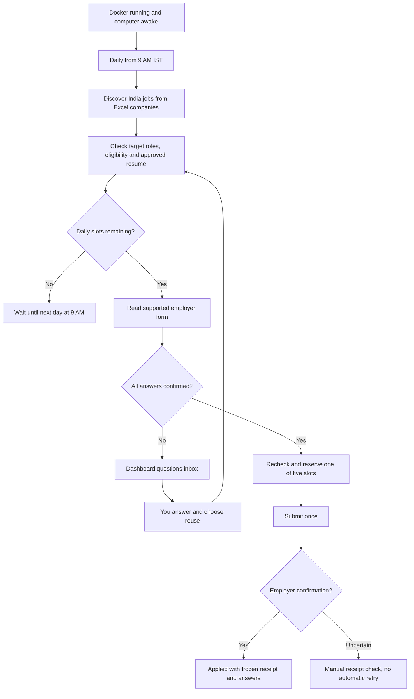

# Phase 10.1 — Daily applications and saved answers

This adds a daily application allowance and an employer-question inbox to Phase 10. All earlier phases remain available.

## How it works and why

1. **9 AM India time.** Managed discovery batches start at 09:00 Asia/Kolkata each day, staggered by two minutes. The sender polls every 30 seconds from 09:00 until midnight. This uses an explicit timezone rather than the computer or container clock settings.
2. **Up to five applications.** The sender checks eligible India jobs matching your saved designations. It keeps the existing posting verification, requirement review and explicit résumé-version approval. Five is a ceiling, not a promise that five suitable jobs exist.
3. **Questions come to your dashboard.** An unknown form question pauses that application before submission. A persistent banner and Background tasks → Answers needed show its exact wording, choices, job and employer link. Other ready jobs can continue.
4. **You confirm the answer.** Choose whether it applies only to this job or can be reused for the exact same question. Optional questions may be left blank. Checkbox declarations always need a job-specific answer. Employer text is treated as data and is never executed as an instruction.
5. **Answers are remembered.** PostgreSQL stores confirmed answers. Reuse requires identical wording, contextual help, input type, required flag and choices. Changing your applicant profile invalidates old answers for future use. You can forget reusable answers from the dashboard. Job-specific answers and historical receipts remain.
6. **The job resumes automatically.** Once all its questions have answers, the sender reopens the current form, rechecks approvals and fills the answers. New or changed questions are shown again. A CAPTCHA, login, unsupported widget or invalid answer requires assisted review.
7. **Reserve a daily slot before sending.** A database lock serializes reservations and an immutable submission-start timestamp consumes a slot. An uncertain result also consumes a slot. This prevents timeout retries or restarts from exceeding the limit.
8. **Save the receipt.** A verified employer confirmation marks Applied and freezes the submitted résumé, profile and additional answers. Uncertain submissions are never automatically repeated.



## Daily behaviour

- If Docker starts after 9 AM, it can use the remaining allowance that same day.
- Missed days do not accumulate. The allowance resets by India calendar day; sending opens at 9 AM.
- Application questions and checks that stop before submission do not consume a slot. A send started at 23:59 counts against that day even if its receipt arrives after midnight.
- This limit covers the automatic sender. Separately recorded manual applications do not consume automated slots.
- Discovery can run while the application allowance is exhausted. Explicitly queued manual discovery retains its existing behaviour.
- Dashboard questions persist when the browser is closed, but there are no email, chat or phone push alerts in this phase.
- Docker cannot wake a sleeping computer. Enable Docker Desktop at sign-in and keep the computer awake for unattended daily runs.
- The pipeline still requires job-specific résumé approval. An 80% match does not approve new résumé wording.

## Daily phone reminder

Google Calendar delivers the reminder independently of Docker, including when the laptop is off. To reproduce the setup, create a private daily event called **Start Job Pipeline** at 09:00 in Asia/Kolkata. Add a notification ten minutes before the event and enable Calendar notifications on your phone.

At 08:50 IST, open today's event. If the laptop is offline, edit **this event only** and enter your reason in the description. The four choices are A (I was sleeping), B (I am out of town), C (I forgot), and D (I will start later). Record the choice as text.

For a later start, move today's event to the time you plan to turn on Docker. For example, moving it to 10:00 sets the reminder for 09:50. Start the laptop and Docker at 10:00 to resume eligible applications under the usual approvals and daily limit. Calendar edits affect the reminder only. If Docker is already running, its 09:00 sending window still applies.

## Implementation

Python handles timezone-aware scheduling. SQLAlchemy and PostgreSQL retain attempts, questions and reusable answers. FastAPI exposes authenticated inbox and answer endpoints. Plain JavaScript polls every 15 seconds without discarding an answer you are typing. The existing Playwright/Chromium adapter reads and fills supported forms.

Migration **0010** adds `submission_started_at`, `form_questions` and `saved_form_answers`. Existing sent/uncertain attempts are conservatively backfilled using their recorded timestamps. No Excel or résumé files are changed.

- GET /dispatch includes the daily schedule, usage and remaining slots.
- GET /dispatch/questions returns pending questions and reusable answers.
- PUT /dispatch/questions/{id} accepts answer, reuse, confirmed=true and expected_profile_version.
- DELETE /dispatch/answers/{fingerprint} removes future cross-job reuse.

## PowerShell upgrade and verification

```powershell
Set-Location 'D:\OFFICIAL WORK\PROJECTS\Somnath Da\Job_Pipeline'
docker compose images
docker image ls
docker compose up -d db
.\.venv\Scripts\python.exe scripts/backup.py create
docker compose config --quiet
docker compose build api worker sender
docker compose run --rm --no-deps -e TEST_POSTGRES=1 api python -m pytest -q -p no:cacheprovider
docker compose run --rm --no-deps sender python -m pytest tests/test_dispatch.py tests/test_daily_answers.py -q -p no:cacheprovider
docker compose up -d --wait
.\.venv\Scripts\python.exe scripts/smoke.py
Start-Process 'http://localhost:8000/'
```

The build retains the existing service image tags and uses available Docker build cache. The application image must be rebuilt to include changed Python and JavaScript files. No image pruning or database-volume removal is required.

Tests use isolated databases and intercepted browser fixtures. They do not send real applications to employers.

## Verification on 18 November 2026

- Full SQLite/PostgreSQL regression suite: 269 passed, 4 skipped.
- Sender and browser checks, including the additional inbox tests: 32 passed, 1 skipped. The skip is the SQLite version of the PostgreSQL row-lock test.
- Tested the 08:59/09:00 India boundary, daily reset, five-slot cap, concurrent reservations, interrupted sends, saved-answer invalidation, receipt snapshots and dashboard answer submission.
- Browser tests used intercepted synthetic employer forms and an isolated dashboard database. No real employer applications were sent by these tests.
- Existing Docker images were inspected before building. PostgreSQL was backed up before migration 0010. Service tags and the existing data volume were retained.
- Live API, PostgreSQL, discovery worker and sender reported healthy. Authenticated smoke checks passed. Sending was verified enabled with a daily limit of five and an Asia/Kolkata 09:00 start; all 88 managed discovery batches were enabled.
