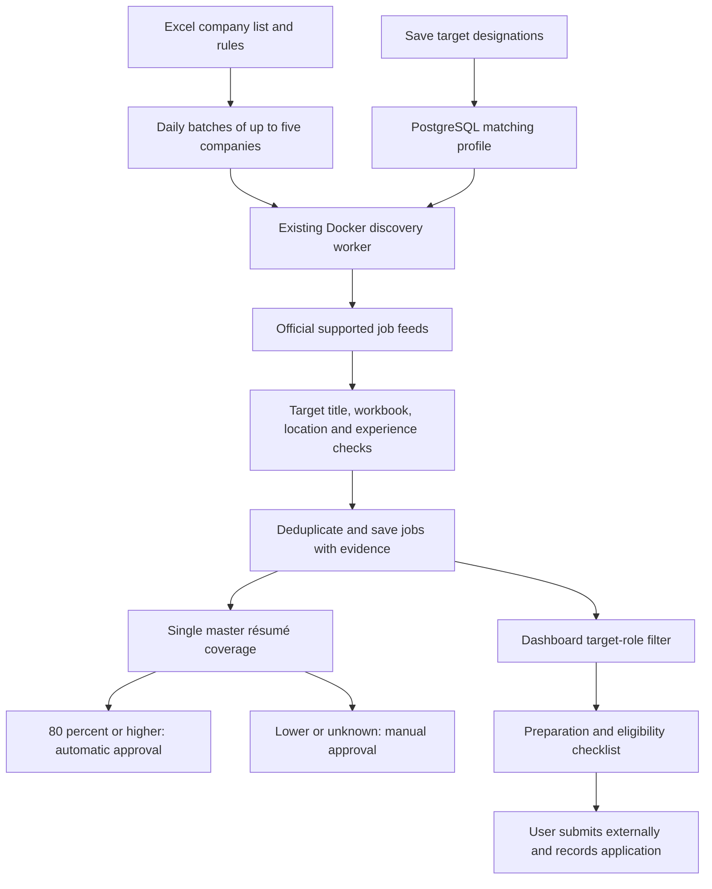

# Phase 8 — Changeable target roles (first increment)

## What and why

Previously, discovery used the same workbook rules regardless of your current career goal. Now you can save AI Engineer, Data Engineer, both, or custom designations in **Background tasks → Target designations**. The setting lives in PostgreSQL and survives Docker restarts. Your selection narrows the workbook search; it never adds skills to your master résumé.

AI Engineer recognizes AI Agent Engineer, Artificial Intelligence Engineer, Generative AI Engineer, GenAI Engineer and LLM Engineer. Data Engineer recognizes Data Engineering, ETL Developer and ETL Engineer. Custom designations use case-insensitive word-boundary phrases in job titles. Data Scientist and Machine Learning Engineer are distinct targets: add them explicitly if desired. Seniority, location and workbook exclusions still apply.

The confirmed initial preferences are AI Engineer and Data Engineer, with willingness to relocate within India and work in office/hybrid roles. This preference does not establish work authorization, availability, salary expectations or eligibility for a particular posting.

## Data flow



## How to use

1. Open the dashboard and select **Background tasks**.
2. Enter one designation per line; save the settings.
3. Click **Enable daily discovery for all Excel companies**. Existing workbook companies are divided into batches of five, staggered by two minutes, repeating every 24 hours. Repeated enable clicks reuse managed schedules. Click enable again after importing additional companies to refresh the batch membership.
4. Keep Docker Desktop and the Compose services running. The single worker processes batches sequentially. Failed or unsupported sources appear in run results; no source failure means “no vacancies.” Each company is bounded to 300 postings from offset zero. Truncated feeds need additional offset runs using the existing controls.
5. Job review defaults to **My target roles**. Select **All roles / history** to inspect older jobs. Changing designations immediately changes this filter and preparation readiness; it does not rewrite historical scores or evidence. A running discovery run finishes with its captured profile; the next run reads the latest selection.
6. Pause cancels queued managed target batches and disables their schedules. A running batch finishes. Independently created schedules are unaffected.

The configured master remains Soumyodeep_Dey_AI_Full Stack.pdf. Approval still uses documented required skills, not the designation or a union of résumé versions. Existing preparation is blocked when its job falls outside the current targets. Submitted application records stay frozen.

## Implementation and alternatives

- **FastAPI/Pydantic:** validate settings and expose `/target-settings` and `/target-settings/automation`. A separate frontend framework is unnecessary for this small form.
- **SQLAlchemy/PostgreSQL JSON:** reuse the matching profile and existing schedule tables, preserving skills and location settings. No migration is required. Separate normalized role tables would be useful if users/accounts are added.
- **Existing Python worker:** performs scheduled discovery independently of the browser. Celery/Redis or n8n are alternatives if distributed queues or visual workflows become necessary.
- **Plain JavaScript:** controls the settings, schedule buttons and job filter without a new build tool.
- **Deterministic title aliases:** explainable and testable; they can miss unusual job titles. Semantic matching could be added later with evidence and evaluation.

## Exact PowerShell commands

```powershell
Set-Location 'D:\OFFICIAL WORK\PROJECTS\Somnath Da\Job_Pipeline'
.\.venv\Scripts\python.exe -m pytest -q -p no:cacheprovider
docker compose config --quiet
docker compose up --build -d --wait
docker compose run --rm -e TEST_POSTGRES=1 api python -m pytest -q -p no:cacheprovider
.\.venv\Scripts\python.exe scripts/smoke.py
Start-Process 'http://localhost:8000/'
```

## Remaining Phase 8 work

This increment automates role-directed discovery, not external applications. Existing résumé assessment and manual preparation remain available. Truthful job-specific PDF generation, a confirmed applicant answer profile, platform-specific form submission, receipt verification and an application queue with daily submission limits are still to be implemented and tested. Unsupported forms, missing answers, login and CAPTCHA require user action. An 80% skill score does not answer these questions or prove submission.


## Assisted external submissions and receipts

An assistant-operated browser can submit a specifically authorized application when the form and applicant facts are available. This is separate from unattended Docker automation. On 4 October 2026, the Observe.AI AI Agent Engineer application in Hyderabad was submitted and confirmed by both the employer page and a Gmail receipt. The master résumé was entered as text through the form's supported manual-entry option because the browser file chooser did not open.

`POST /jobs/{job_id}/application-receipt` records a verified external submission with its imported résumé ID, date, channel and nonblank receipt reference. It does not submit anything, manufacture an approval or claim that readiness checks were satisfied. Duplicate recording is rejected and the receipt snapshot is frozen. This allows accurate history even when the original job's coverage was unknown. The normal preparation workflow keeps its approval checks.

Gmail is connected to Codex and an hourly thread automation monitors replies for tracked applications. This connection and automation do not run inside Docker. The Docker pipeline still needs a separate Gmail OAuth integration to poll email independently of Codex. LinkedIn requires browser sign-in; Naukri, Foundit, Cutshort, Y Combinator and Wellfound accounts are not yet confirmed or connected. Never put passwords, session cookies or OAuth tokens in committed files.

The user requested all eligible matches rather than a fixed daily count. This preference does not enable unattended submissions: each platform still needs a supported, tested flow, confirmed applicant answers, duplicate checks and receipt verification. Local connection status is recorded in ignored `backups/account-connections.json`; it contains no passwords or tokens.
