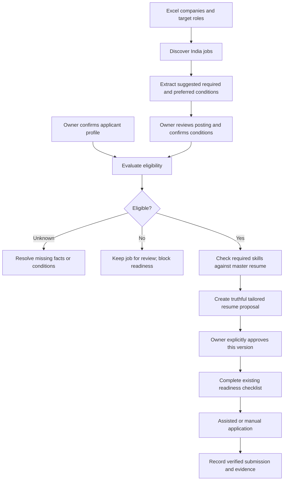

# Phase 9 — Confirmed applicant profile and eligibility

Phase 9 adds reusable applicant facts and reviewed job conditions to the existing pipeline. Phases 1–8 remain available. It does not submit applications automatically.

## Flow and reasons



1. **Confirm your profile.** Open Applicant profile in the dashboard. Save only facts you can verify: India work authorization, sponsorship needs, accepted work arrangements, relocation, relevant experience, notice period and availability. Unknown answers remain unknown. This prevents the system from inventing personal facts. No real applicant profile is populated by this upgrade.
2. **Review the actual posting.** Open a job and review suggested mandatory and preferred skills, India eligibility, office city, work mode and other conditions. Extraction uses deterministic Python rules, not a comprehensive understanding of the posting. Preferred skills do not increase mandatory-skill coverage. Degree, certification or other unparsed conditions stay unresolved until you check them.
3. **Confirm requirements with a review note.** Suggestions alone are never sufficient. The system stores the source fingerprint and review version. Changed posting evidence invalidates the review. A new review also invalidates earlier tailored-resume approval, so the exported resume stays tied to the reviewed job.
4. **Evaluate eligibility.** Confirmed incompatible conditions produce `not_eligible`; missing or unresolved facts produce `needs_clarification`; otherwise the result is `eligible`. This covers reviewed non-skill conditions, not hiring probability. Experience compares the confirmed number of years; you must check that the experience is relevant to the posting.
5. **Prepare and approve the resume.** Existing required-skill coverage, target designation, master-resume evidence and readiness checks still apply. The 80% job-match rule never replaces explicit approval of job-specific resume wording.
6. **Use confirmed answers.** Reusable answers include the profile version and preserve explicit No and zero values. Expected CTC is annual INR lakhs per annum. These answers are not automatically sent to an employer. No salary negotiation or offer acceptance is implemented.
7. **Record and audit.** Saved assessments, profile revisions and requirement-review history explain decisions. Normal submission records preserve the eligibility and answer snapshot used at that time. Later profile edits do not rewrite submitted history. Existing verified historical receipts remain intact.

## Technology choices

Python holds validation and matching logic. FastAPI exposes authenticated APIs. Pydantic rejects malformed or unconfirmed input. SQLAlchemy stores profile versions, reviews and assessments in PostgreSQL. Alembic migration `0007` adds four tables without deleting existing jobs. Existing plain JavaScript renders dashboard forms without a new frontend framework. Docker Compose runs the API, database and worker together. Pytest checks eligibility, stale versions, approval invalidation and historical snapshots.

## API routes

All routes require the existing owner authentication.

| Route | Purpose |
| --- | --- |
| GET / PUT `/applicant-profile` | Read or confirm profile with expected version |
| GET `/applicant-profile/history` | Profile audit history |
| GET `/applicant-profile/answers` | Reusable confirmed answers |
| GET / PUT `/jobs/{job_id}/requirements` | Suggested and confirmed posting conditions |
| GET `/jobs/{job_id}/eligibility` | Current eligibility without saving |
| POST `/jobs/{job_id}/eligibility/assess` | Save an assessment |
| GET `/jobs/{job_id}/eligibility/history` | Saved assessments |
| GET `/jobs/{job_id}/application-answers` | Answers and current eligibility |

Profile and requirement updates require explicit confirmation and expected version. Requirement updates also require the current source hash and a review note. Conflicting updates return 409. Submitted jobs have frozen requirement reviews.

## Upgrade and verify in PowerShell

```powershell
Set-Location 'D:\OFFICIAL WORK\PROJECTS\Somnath Da\Job_Pipeline'
.\.venv\Scripts\python.exe scripts/backup.py create
docker compose config --quiet
docker compose run --build --rm -e TEST_POSTGRES=1 api python -m pytest -q -p no:cacheprovider
docker compose up --build -d --wait
docker compose ps
Invoke-RestMethod 'http://localhost:8000/health'
.\.venv\Scripts\python.exe scripts/smoke.py
Start-Process 'http://localhost:8000/'
```

The local PostgreSQL host port is now 15432 because Windows refused 55432 after the Docker update. Internal database traffic remains `db:5432`. Existing data volumes are preserved. Never use `docker compose down -v` to fix a port conflict.

## Next phases

Proposed Phase 10: one employer-platform adapter with a reviewed preview, explicit authorization, duplicate protection and verified receipts. Proposed Phase 11: broader India source coverage and platform-specific integrations where supported. Proposed Phase 12: operational hardening, measured matching quality and optional hosted deployment. These are proposals, not implemented functionality. Captchas, login challenges and ambiguous application questions require user action.
